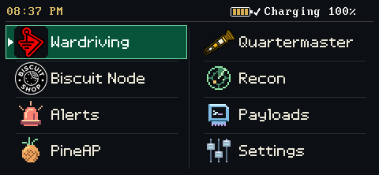
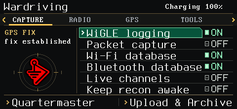

# BWM-Wardriver

Version **2.4.2** by **Valleytech Solutions / Your Pal Kal**. Developed for WiFi Pineapple Pager **2.1.0 Stable**, theme framework **0.9**.

A black-and-gold terminal layout puts eight destinations, the clock and the battery percentage on one Home screen. The D-pad cursor uses deep green, near-white lettering and an arrow. The boot and loading screens feature the VTS and BWM marks.

## Navigation

Use the D-pad to move, A to select and B to go back. From Wardriving on Home, press Right for Quartermaster or Down for Biscuit Node. Each opens the Pager's launch confirmation.

Wardriving has four pages covering Capture, Radio, GPS and Tools. Left and Right switch pages while a setting is selected. Up and Down move the cursor. Each switch shows its current state in a separate column. Press Up from the first setting to reach Quartermaster, then Left or Right to choose between Quartermaster and Upload & Archive. GPS coordinates require device location data. The baud and restart controls apply to GPSd mode.

In the GPS serial port picker, the green row shows where the D-pad will act. A filled circle marks the current port. Moving the cursor to Cancel leaves that circle on the port. Confirmation prompts show **No** and **Yes** beside their symbols. The button under the cursor turns green. [Port focused](previews/device-gps-port.png) · [Cancel focused with the port still marked](previews/device-gps-cancel.png).

## Installation

Copy this repository's `bwm-wardriver` directory to the Pager as `/root/themes/BWM-Wardriver/`. The `theme.json` file belongs directly in that folder. Under **Settings > General > Theme**, select **BWM-Wardriver** and confirm the UI reload. To open it in Theme Studio Pro, zip the theme folder and choose **Theme > Load zip**.

## Optional payload shortcuts

Each shortcut requires its payload to be installed separately at the path below. Home and the native dashboard controls can be used independently of these payloads.

| Shortcut | Payload directory on the Pager |
| --- | --- |
| Quartermaster | `/root/payloads/user/reconnaissance/quartermaster` |
| Biscuit Node | `/root/payloads/user/reconnaissance/biscuit_pager_node` |
| Upload & Archive | `/root/payloads/user/exfiltration/valleytech_wigle_upload` |

The Quartermaster and Biscuit Pager Node projects provide installation instructions. For Upload & Archive, copy the complete companion directory, including its `lib` subdirectory. [Quartermaster for Pager](https://github.com/valleytechsolutions/Quartermaster-Pager) · [Biscuit Pager Node by GSHD and Hedge](https://github.com/CodeHedge/wifipineapplepager-payloads/tree/master/library/user/reconnaissance/biscuit_pager_node) · [WiGLE companion source and installation instructions](https://github.com/valleytechsolutions/wifipineapplepager-payloads/tree/f480700a5fc85cca1fb78686e7c03309713c1b17/library/user/exfiltration/valleytech_wigle_upload).

## Compatibility and credits

The GPS picker and the confirmation dialog were checked on a connected Pager. The Pager froze during a UI reload. Home returned after a power cycle. The cause is unknown. Outdoor readability, field GPS and live WiGLE uploads remain unverified. [Validation details](VALIDATION.md).

Valleytech Solutions supplied the layout and Home artwork. The Wardriving mark represents Black Wire Militia (BWM), the spyglass identifies Quartermaster, and the circular Biscuit Shop mark identifies Biscuit Node. [Biscuit Shop](https://biscuitshop.us/).

The theme builds on Zombie Joe's Zombie Kal and uses compatibility components from Hak5 Wargames. The original author note is included. [Zombie Joe's theme repository](https://github.com/Zombie-Joe/zombie-themes) · [Original author note](UPSTREAM_README.txt) · [Hak5 Wargames](https://github.com/hak5/wifipineapplepager-themes/tree/a9aaba66f3fdd3f4db9ef69e18513e31c5b09b28/themes/wargames) · [Hak5 Software License Agreement](https://hak5.org/license).
