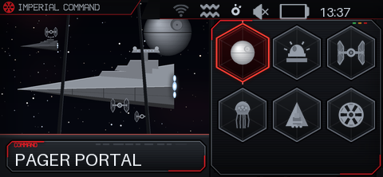

# Imperial

| | |
|---|---|
| **Theme name** | Imperial (`imperial`) |
| **Author** | RootJunky |
| **Version** | 1.0.0 |
| **Firmware** | Hak5 WiFi Pineapple Pager firmware **2.1.0** · theme framework 0.9 · built from the stock Wargames theme v2.0.0 |

## Description / inspiration
Dark-side Star Wars theme: every screen, dialog, keyboard and icon redrawn as
Imperial hardware — Star Destroyer bridge, Death Star corridors, TIE fighters,
probe droids and the Imperial crest. Black / gunmetal / steel with Imperial red.
Based on stock Wargames 2.0.0 (framework 0.9). Personal fan theme.

## Screens
- **Home** — bridge viewport (Star Destroyers, TIE escort, Death Star) + command
  console with six hex TIE-wing buttons: Pager Portal = Death Star, Alerts = alarm
  beacon, Payloads = TIE fighter, Recon = probe droid, PineAP = Star Destroyer,
  Settings = Imperial crest. Selected name shows on the COMMAND plate.
- **Boot** — seamless hyperspace loop with pulsing crest, "GALACTIC EMPIRE".
- **Menus** — Settings / PineAP / Alerts / Payloads (TIE in a hangar rack) /
  Recon payloads (probe droid scan) / Pager Portal (HoloNet Death Star) / Recon graph.
- **Dialogs** — chamfered gunmetal consoles: info (steel), warning (amber + hazard),
  error (red + targeting reticle), confirm, option pickers, edit/launch dialogs.
- **Launch** — TIE fighter firing in a launch-tube viewport.
- **Keyboards** — all 6 layouts as gunmetal keypads (geometry identical to stock).
- **System** — blast-door lock screens, battery alerts, reactor overheat/dimming,
  HoloNet uplink update screens, QR info screens (QR codes untouched), spinner.
- **Icons** — blaster-bolt menu pointer, TIE list pointer, hex radios/toggles,
  Star Destroyer launch glyph, steel status bar.

## Palette (theme.json)
normal text `blue` = steel white · selected `yellow` = Imperial red · `green` (on/ok)
= bright steel · `magenta` = crimson · `cyan` = hologram blue · warnings amber.

## How it was made
All artwork is original and drawn with code (Python/Pillow scripts). Keyboard key
positions are taken from the stock Wargames layouts, so every key stays on the
firmware's hit box.

## Known limitations
- Tested on a WiFi Pineapple Pager running firmware 2.1.0. Hak5 does not
  guarantee theme compatibility across firmware versions, so later firmware may
  need updates.
- A few text colours were changed in component JSON so they stay readable on
  the dark art. The lock screen hint and the tutorial text use `soft_white`
  instead of `black`.
- Screen text (menu items, titles, values) is drawn by the firmware, so it uses
  the stock font, not the themed lettering baked into the artwork.
- Unofficial fan theme. Star Wars names and designs belong to Lucasfilm; all
  artwork here is original, drawn with code.
- There is no green in this palette: on/OK states use bright steel to stay on theme.

## Install
Copy the folder (or unzip the package) to `/root/themes/imperial/` on the Pager
and select it under Settings → Display → Theme.
