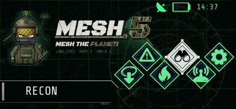
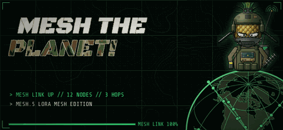
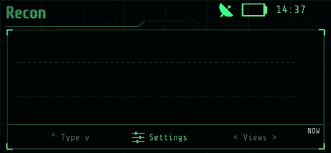
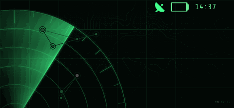
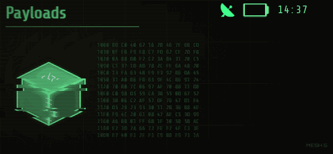
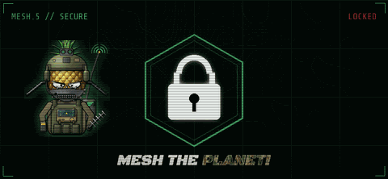

# MESH.5 Pager Theme

**Author:** SECT0101
**Theme version:** 1.0.0
**Firmware:** developed and tested on WiFi Pineapple Pager firmware 2.0.0-stable
**Built on:** the official `wargames` reference theme from hak5/wifipineapplepager-themes (`theme_framework_version` 0.9)

A LoRa mesh theme for the Hak5 WiFi Pineapple Pager, made to go with the [PagerMesh](https://github.com/SECT0101/PagerMesh) Meshtastic payload. It looks like a mesh network screen in Meshtastic green on black: dark terrain, grid lines, topographic contours, mesh nodes linked hop to hop, radar range rings and a LoRa radio boot log. Distressed headings, scanlines and glitch frames keep a 90s hacker-movie edge.

The menu cursor is a small gunmetal MESH.5 shield. The **MESH.5** wordmark follows the Hak5 style: white distressed MESH, an underline ending in a square dot, and an oversized woodland-camo 5.

**MESH THE PLANET!** The boot sequence ends with the slogan glitching in while Tac-Pine stands on a wireframe globe laced with mesh links, a node at every hop. The slogan also sits under the MESH.5 wordmark on the home screen and under the padlock on the lock screen.

**Tac-Pine** is back as a mesh operator: a pineapple in a high-cut helmet with NVGs, a headset and a spiked muzzle mask, with a coyote WiFi Pineapple Pager chest-mounted and showing the mesh, and a LoRa whip antenna sending signal both ways.

Matching ringtones (`MESH5_*.rtttl`) are in the [WiFi Pineapple Pager ringtone library](https://github.com/hak5/wifipineapplepager-ringtones/tree/master/ringtones).

## Color language

| Role | Color |
|---|---|
| Normal items | Meshtastic green |
| Selected items and titles | White |
| Warnings | Amber |
| Alerts and errors | Red |
| Success | Bright green |

## Install

1. Copy the `mesh5` folder to `/root/themes/` on the Pager (create `themes` if it doesn't exist):
   `scp -r mesh5 root@172.16.52.1:/root/themes/`
2. On the Pager, go to **Settings > Display > Theme** and pick **mesh5**.

While testing a new theme, run Hak5's `tools/theme-guard.sh` from the themes repo. If the theme makes the UI crash-loop, it switches back to the default theme.

## Known limitations

- The images were drawn against the `wargames` reference layout. Every file name and image size matches that reference, so menus, keys and dialogs keep their positions. A future firmware that changes the reference layout may need this theme rebuilt.
- Text drawn by the firmware (menu items, list entries) uses the device's built-in font. Only the screen titles, boot and lock art use the theme's own lettering.
- Small icons (other than the shield menu cursor) are the stock Hak5 icons, recolored by the palette at runtime.

## Credits

- Layout and component structure come from Hak5's `wargames` reference theme.
- Lettering in the images uses Black Ops One, Saira Condensed, Share Tech, Share Tech Mono and Orbitron (SIL Open Font License). No font files are shipped; the text is rendered into the PNGs.
- Tac-Pine and all other artwork are original to this theme.
- Globe coastlines: [Natural Earth](https://www.naturalearthdata.com/) 1:110m land (public domain).

Unofficial community theme. Not affiliated with Hak5 LLC or Meshtastic LLC.
