# netrunner-od3sa

**Author:** Yakov Khalinsky

A neon-on-black re-skin of the default **wargames** theme, based on my Omarchy
[netrunner](https://github.com/yakovkhalinsky/omarchy-files/tree/main/theme/netrunner) desktop theme:
accent `#00ff9f`, cyan `#00f0ff`, hot red `#ff2a6e`, magenta `#ff10f0`, on a near-black background.

## Description / inspiration

- Built from **wargames** (theme_version 2.0.0, theme_framework_version 0.9), rebased on the copy in
  `hak5/wifipineapplepager-themes` at commit `11ade42`. Layouts and components are unchanged from wargames,
  so every screen and template is the stock one.
- `theme.json` `color_palette` remapped to the netrunner palette:
  - normal text/chrome (`blue`) → cyan `#00f0ff`
  - selected items and titles (`yellow`) → accent green `#00ff9f`
  - errors/alerts (`red`) → `#ff2a6e`
  - secondary/disabled grays → green-tinted neutrals for readability
- Raster assets were recoloured with Pillow by remapping hue bands. For palette PNGs only the palette entries
  change; for RGBA PNGs each pixel changes but alpha is kept. Image sizes and alpha are identical to wargames.
  - light-blue chrome → cyan
  - navy panels → dark green
  - yellow highlights → accent green (warnings stay yellow)
  - reds, oranges and magentas → the netrunner equivalents
- The dashboard background blends a dimmed crop of the netrunner street wallpaper into its dark area.
- The payload log default text uses `#d4f5e0` and its error text uses `#ff2a6e`.

## Known limitations

- Running on a real WiFi Pineapple Pager with firmware 2.0.0. It was also validated offline: JSON parses,
  all references resolve, and image sizes match wargames.
- Uses the green/cyan family heavily, so `yellow` (selection) and `green` (enabled/success) are close in hue
  (`#00ff9f` vs `#39ffbf`).
- QR code images (`help_qr`, `license_qr`, `virt_qr`) are intentionally left as in wargames.
- Boot frames, upgrade screens and spinners are recoloured wargames art, not new artwork.
- A different community theme is also named `netrunner` (Doc Voom, Cyberpunk 2077). Installing both into
  the same `themes/` directory will clash, so rename one directory.

## Firmware

Developed for Pager firmware **2.0.0** (wargames theme_version 2.0.0, theme framework **0.9**).
It will show framework/missing-component warnings on 1.x firmware.

2.0 screens covered (all from the wargames 2.0.0 base, recoloured to the netrunner palette):
- Bluetooth recon list, selected device and advertising-data screens (`bt_recon_*`, `bt_rssi_*`, `bt_signal`)
- Help pages on settings / PineAP rows (`*_explained` menus, `help.png`)
- GPS advanced settings and Bluetooth settings submenus
- Start New Scan chooser (`recon_new_scan_submenu`)
- Quick Settings and the Sleep Screen entry on the power menu
- New status-bar icons: BT scan, BT mode (classic/LE/both), database, GPS states; new `bt_recon` status bar

## Install

```
scp -r netrunner-od3sa/ root@172.16.52.1:/mmc/root/themes/
```
Then select it under **Settings > Display > Theme**.

## Screenshots

_Mock renders from the theme files (the theme itself runs on a real Pager with firmware 2.0); boot frames are the theme's own images._

| | |
|---|---|
| 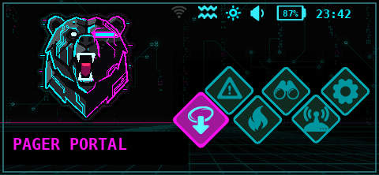 | 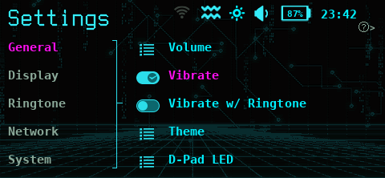 |
| 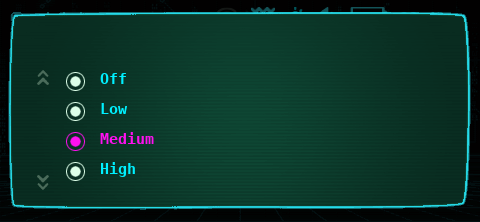 | 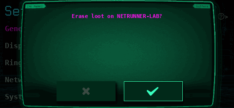 |
| 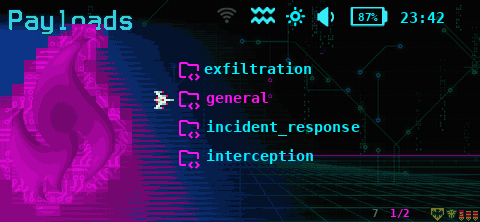 | 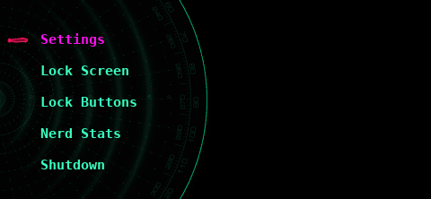 |
| 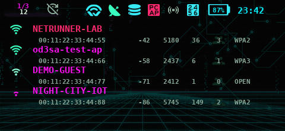 | 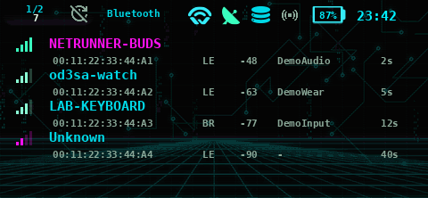 |

### Boot screen

The "JACKING IN" boot animation, taken frame for frame from the theme's own boot images.

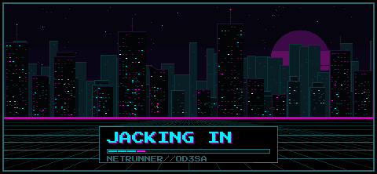

| | |
|---|---|
|  | 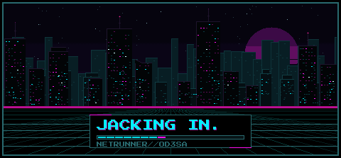 |
| 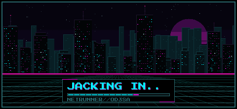 | 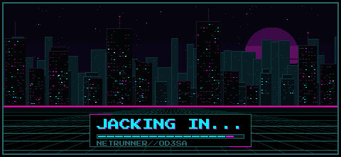 |
