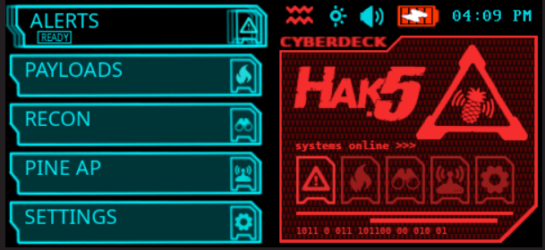
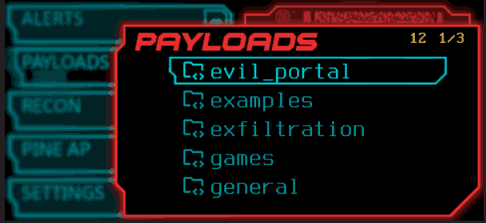
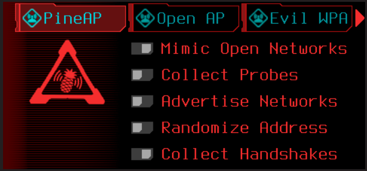
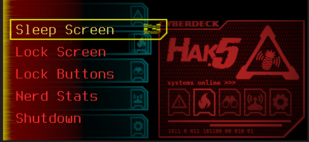

# NETRUNNER (Version 2.0)
### Author: Doc Voom

Theme for the WIFI-Pineapple Pager based off of the **Cyberpunk 2077** Quickhacks system.

## Version 2.0 Updates
**Updated for firmware 2.0**

- Complete overhaul of the graphics including backgrounds, menus, radio, and toggles
- All new layout for PineAP and Settings screens
- 24-hour clock option is on the second page of the Date/Time settings
- Pager Portal is located in Settings > Updates
- This version does not include the "Explained" screens

