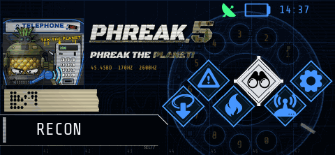
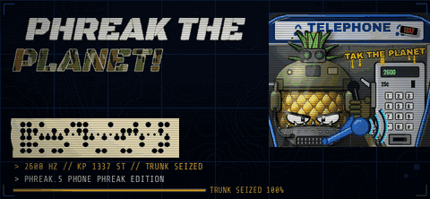
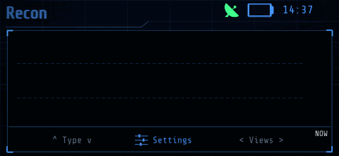
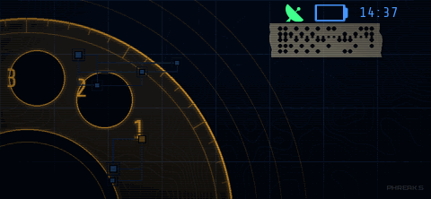
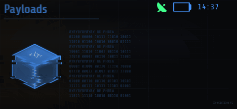
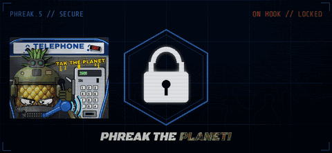

# PHREAK.5 Pager Theme

**Author:** SECT0101
**Theme version:** 1.0.0
**Firmware:** developed and tested on WiFi Pineapple Pager firmware 2.1.0
**Built on:** the official `wargames` reference theme from hak5/wifipineapplepager-themes (`theme_framework_version` 0.9)

An old-school phone phreak theme for the Hak5 WiFi Pineapple Pager, made to go with the [PagerRTTY](https://github.com/SECT0101/PagerRTTY) payload and its Phone Phreak menu. Payphone blue on black with amber CRT text: rotary dials, punched Baudot tape, teleprinter printouts, a phone switch network on right-angle trunk lines and an oscilloscope showing the RTTY mark and space tones. Scanlines and glitch frames keep the 80s hacker edge.

The menu cursor is a small gunmetal shield. The **PHREAK.5** wordmark follows the Hak5 style: white distressed PHREAK, an underline ending in a square dot, and an oversized woodland-camo 5.

**PHREAK THE PLANET!** The boot log brings up the Baudot, 2600 Hz and MF keypulse settings, then ends with the slogan glitching in while Tac-Pine works the phone booth and a strip of Baudot tape spells PHREAK THE PLANET! in real ITA2 code. The slogan also sits under the wordmark on the home screen and under the padlock on the lock screen.

**Tac-Pine** is in the phone booth from the PagerRTTY logo, handset in one hand and the blue 2600 Hz whistle in the other.

Matching ringtones (`PHREAK5_*.rtttl`) are in the [WiFi Pineapple Pager ringtone library](https://github.com/hak5/wifipineapplepager-ringtones/tree/master/ringtones). The theme source, art and build scripts are in [SECT0101/PagerRTTYTheme](https://github.com/SECT0101/PagerRTTYTheme).

## Color language

| Role | Color |
|---|---|
| Normal items | Payphone blue |
| Selected items | White |
| Status text | Amber |
| Alerts and errors | Red |
| Success | Green |

## Install

1. Copy the `phreak5` folder to `/root/themes/` on the Pager (create `themes` if it doesn't exist):
   `scp -r phreak5 root@172.16.52.1:/root/themes/`
2. On the Pager, go to **Settings > Display > Theme** and pick **phreak5**.

While testing a new theme, run Hak5's `tools/theme-guard.sh` from the themes repo. If the theme makes the UI crash-loop, it switches back to the default theme.

## Known limitations

- The images were drawn against the `wargames` reference layout. Every file name and image size matches that reference, so menus, keys and dialogs keep their positions. A future firmware that changes the reference layout may need this theme rebuilt.
- Text drawn by the firmware (menu items, list entries) uses the device's built-in font. Only the screen titles, boot and lock art use the theme's own lettering.
- Small icons (other than the shield menu cursor) are the stock Hak5 icons, recolored by the palette at runtime.

## Credits

- Layout and component structure come from Hak5's `wargames` reference theme.
- Lettering in the images uses Black Ops One, Saira Condensed, Share Tech, Share Tech Mono and Orbitron (SIL Open Font License). No font files are shipped; the text is rendered into the PNGs.
- Tac-Pine and all other artwork are original to this theme.

Unofficial community theme. Not affiliated with Hak5 LLC.
