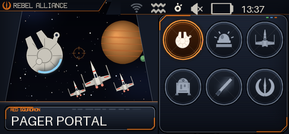

# Rebel

| | |
|---|---|
| **Theme name** | Rebel (`rebel`) |
| **Author** | RootJunky |
| **Version** | 1.0.0 |
| **Firmware** | Hak5 WiFi Pineapple Pager firmware **2.1.0** · theme framework 0.9 · built from the stock Wargames theme v2.0.0 |

## Description / inspiration
Light-side Star Wars theme, the counterpart to Imperial. Every screen, dialog,
keyboard and icon is redrawn as Rebel Alliance hardware: X-wings, the Millennium
Falcon, astromech droids, lightsabers, Yavin and the Rebel starbird. Night-navy
and slate panels with rounded corners, cream text, Rebel flight-suit orange and
lightsaber green. Based on stock Wargames 2.0.0 (framework 0.9). Personal fan theme.

## Screens
- **Home**: X-wing cockpit view (Falcon, Red Squadron X-wings, Yavin) plus a
  console of six round buttons. Pager Portal = Millennium Falcon, Alerts = alarm
  beacon, Payloads = X-wing, Recon = astromech, PineAP = lightsaber,
  Settings = Rebel starbird. The selected name shows on the RED SQUADRON plate.
- **Boot**: seamless hyperspace loop with the starbird, X-wings and "REBEL ALLIANCE".
- **Menus**: Settings (starbird watermark), PineAP (Falcon watermark), Alerts,
  Payloads (X-wing in a hangar rack), Recon payloads (astromech hologram),
  Pager Portal (Yavin with X-wings), Recon graph.
- **Dialogs**: rounded slate consoles. Info is holo blue, warning amber with hazard
  stripes, error red with a targeting reticle. Also confirm, option pickers, and
  the edit and launch dialogs.
- **Launch**: head-on X-wing firing all four cannons ("RED FIVE STANDING BY").
- **Keyboards**: all 6 layouts as slate keypads (geometry identical to stock).
- **System**: lock screens with the starbird, battery alerts, Death Star explosion
  for overheat, Tatooine twin suns for dimming, Alliance uplink update screens,
  QR screens (QR codes untouched), and an X-wing spinner.
- **Icons**: green lightsaber menu pointer, X-wing list pointer, round radios and
  toggles, X-wing launch glyph.

## Palette (theme.json)
- Normal text `blue` = cream.
- Selected `yellow` = Rebel orange.
- `green` (on/ok) = lightsaber green.
- `magenta` = coral.
- `cyan` = holo blue.
- Red is used only for errors and critical states.

## How it was made
All artwork is original and drawn with code (Python/Pillow scripts). Keyboard key
positions are taken from the stock Wargames layouts, so every key stays on the
firmware's hit box.

## Known limitations
- Not yet tested on real Pager hardware; screens were checked with the
  project's approximate previewer (`tools/preview.py`), not the device.
- Recoloured icons assume the firmware replaces the icon's RGB with the flat
  palette colour and keeps its alpha. If the firmware shades instead, some
  small glyphs may look slightly different.
- Header artwork sits under the firmware status bar. If the firmware paints
  a solid strip behind the status icons, part of the header art is hidden.
- A few text colours were changed in component JSON so they stay readable on
  the dark art. The lock screen hint and the tutorial text use `soft_white`
  instead of `black`.
- Screen text (menu items, titles, values) is drawn by the firmware, so it uses
  the stock font, not the themed lettering baked into the artwork.
- Unofficial fan theme. Star Wars names and designs belong to Lucasfilm; all
  artwork here is original, drawn with code.
- Red is reserved for errors and critical alerts. All other accents use Rebel orange.

## Install
Copy the folder (or unzip the package) to `/root/themes/rebel/` on the Pager
and select it under Settings → Display → Theme.
