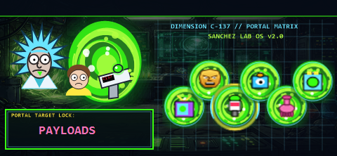

# rickandmorty

A Rick and Morty fan theme for the Hak5 WiFi Pineapple Pager: dark "Dimension C-137" terminal dialogs, portal-green accents, and themed alerts, keyboards, boot animation and upgrade screens.



| | |
|---|---|
| **Theme name** | rickandmorty (Rick and Morty fan theme) |
| **Author** | h4d35x0 |
| **Theme version** | 2.0.0 |
| **Theme framework** | 0.9 |
| **Firmware developed for** | 2.0.0-stable |

## Install

Copy this directory to the Pager, then select it in Settings:

```sh
scp -r rickandmorty root@172.16.52.1:/mmc/root/themes/
```

The Theme Switcher payload can also preview and activate it: https://github.com/h4d35x0/pineapple-pager

## What's in it

- High-contrast dialogs: option, launch, alert, confirmation and string-edit dialogs keep dark interiors with status bars along the bottom edge, so payload titles and list rows stay readable.
- Themed dashboards for payloads, recon, PineAP, alerts, settings and the Pager Portal.
- Custom on-screen keyboards (alphanumeric, symbols, hex, IP, numeric).
- Boot animation, battery, thermal, lock-screen and firmware-upgrade screens.
- Nine RTTTL ringtones in `ringtones/`.
- Easter egg: press **B** on the main dashboard, or **Down** on the power menu.
- `color_palette_preview.html` shows the 30-colour palette (generated with Hak5's `generate_color_palette.sh`).

## Credits

Built on the layout and component structure of Hak5's default **wargames** theme. The help, license and Virtual Pager QR codes are Hak5's originals from that theme. Several component files keep their wargames names (for example `components/dashboards/wargames_dashboard.json`).

## Known limitations

- Unofficial, non-commercial fan theme. Not affiliated with, sponsored by, or endorsed by the creators or rights holders of *Rick and Morty*, or by Hak5. *Rick and Morty* and its characters belong to their respective owners. Not for sale. See [NOTICE.md](https://github.com/h4d35x0/pineapple-pager/blob/main/NOTICE.md); rights holders can request removal by opening an issue on that repository.
- Written for theme framework 0.9 on firmware 2.0.0-stable. Hak5 does not guarantee theme compatibility across firmware versions. If a later firmware adds components this theme does not define, the Pager falls back to its built-in theme and writes `/tmp/uierrors.log`.
- The hardware boot framebuffer screens shown before the UI starts are not part of a theme and are not included.
