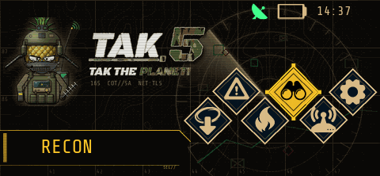
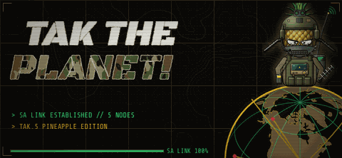
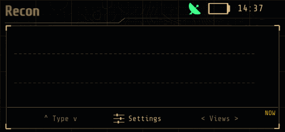
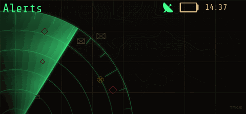
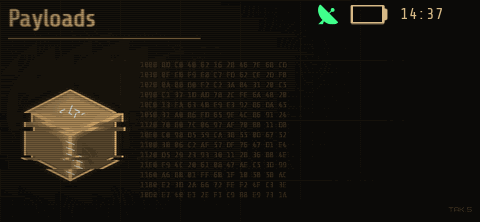
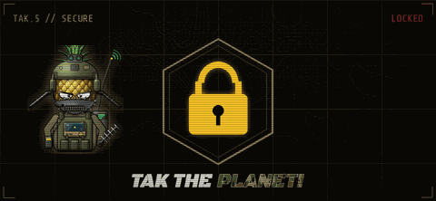

# TAK5 Pager Theme

**Author:** SECT0101
**Theme version:** 1.0.0
**Firmware:** developed and tested on WiFi Pineapple Pager firmware 2.0.0-stable
**Built on:** the official `wargames` reference theme from hak5/wifipineapplepager-themes (`theme_framework_version` 0.9, repo state of 2026-11-05)

A tactical TAK (Team Awareness Kit) theme for the Hak5 WiFi Pineapple Pager, with a 90s hacker-movie edge. It looks like a TAK map screen in coyote tan: dark terrain, MGRS-style grid lines, topographic contours, MIL-STD-2525 affiliation frames, radar range rings and a CoT terminal boot. Distressed headings, scanlines and glitch frames add the hacker side.

The menu cursor is a small TAK.5 shield. The **TAK.5** wordmark follows the Hak5 style: white distressed TAK, an underline ending in a square dot, and an oversized woodland-camo 5.

**TAK THE PLANET!** The boot sequence ends with the slogan glitching in while Tac-Pine stands on a wireframe globe centered on Tennessee, with CoT links reaching out across the world. The slogan also sits under the TAK.5 wordmark on the home screen and under the padlock on the lock screen.

Meet **Tac-Pine**, the TAK.5 mascot: a pineapple operator in a high-cut helmet with NVGs, a headset, a spiked muzzle mask and four antennas. He wears an OD plate carrier with a coyote-brown WiFi Pineapple Pager chest-mounted as his EUD, carries a manpack radio with a whip antenna, a PTT handset and a handheld yagi.

Matching ringtones (`TAK5_*.rtttl`) are in the [WiFi Pineapple Pager ringtone library](https://github.com/hak5/wifipineapplepager-ringtones/tree/master/ringtones).

## Color language

| Role | Color |
|---|---|
| Normal items | Coyote tan |
| Selected items and titles | Amber |
| Alerts and errors | Hostile red |
| Success and recon | Neutral / phosphor green |

## Install

1. Copy the `tak5` folder to `/root/themes/` on the Pager (create `themes` if it doesn't exist):
   `scp -r tak5 root@172.16.52.1:/root/themes/`
2. On the Pager, go to **Settings > Display > Theme** and pick **tak5**.

While testing a new theme, run Hak5's `tools/theme-guard.sh` from the themes repo. If the theme makes the UI crash-loop, it switches back to the default theme.

## Known limitations

- The images were drawn against the `wargames` reference layout. Every file name and image size matches that reference, so menus, keys and dialogs keep their positions. A future firmware that changes the reference layout may need this theme rebuilt.
- Text drawn by the firmware (menu items, list entries) uses the device's built-in font. Only the screen titles, boot and lock art use the theme's own lettering.
- Small icons (other than the shield menu cursor) are the stock Hak5 icons, recolored by the palette at runtime.

## Credits

- Layout and component structure come from Hak5's `wargames` reference theme.
- Lettering in the images uses Black Ops One, Saira Condensed, Share Tech and Share Tech Mono (SIL Open Font License). No font files are shipped; the text is rendered into the PNGs.
- Tac-Pine and all other artwork are original to this theme.
- Globe coastlines: [Natural Earth](https://www.naturalearthdata.com/) 1:110m land (public domain).

Unofficial community theme. Not affiliated with Hak5 LLC or the TAK Product Center.
