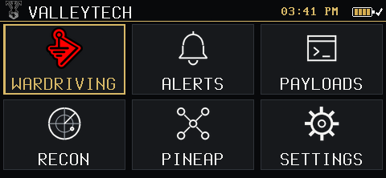
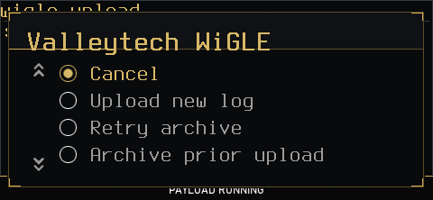

# Valleytech Theme

Version **2.1.0** by **Valleytech Solutions / Your Pal Kal**, developed for
WiFi Pineapple Pager **2.0.0 Stable**, theme framework **0.9**.

Based on **Zombie Joe's Zombie Kal**, with compatibility components from
**Hak5 Wargames**. This revision uses black, gold, white and gray, the supplied
Valleytech Solutions mark, and the BWM mark in its original red.

## Layout

Six large labeled tiles show Wardriving, Alerts, Payloads, Recon, PineAP and
Settings together. The D-pad moves directly between tiles; A selects and B
returns.

The Wardriving dashboard brings the 24 existing controls and an Upload & Archive
shortcut onto one page. Capture, Radio, GPS and Tools columns group the controls.
Compact labels expand in the header when focused. Up from the first control
wraps to Upload & Archive. Both dashboards stay on one screen; native lists can
still paginate when there are more networks, payloads or files than will fit.

Flat panels replace the large circuit borders in menus, lists, dialogs and
system notices. Boot, loading and lock screens use both supplied logos. The
loading screen retains the firmware's operation message, and temperature and
battery notices retain their meaning. Native keyboard geometry and QR screens
are preserved.

## Installation

Copy this complete `valleytech_theme` folder into `/root/themes/` (also exposed
as `/mmc/root/themes/`), then select **Settings > General > Theme > Valleytech
Theme**. Keep the previous theme folder for rollback through the same menu.

To edit it in Theme Studio Pro, load a ZIP containing this folder. The home
component is `components/dashboards/wargames_dashboard.json`; Wardriving is
`components/dashboards/dashboard_wardriving.json`.

## Optional WiGLE companion

The core theme works without an additional payload. **Upload & Archive** requires
the separately installed **Valleytech WiGLE Upload 0.1.0** companion:

- [Pinned companion source and instructions](https://github.com/valleytechsolutions/wifipineapplepager-payloads/tree/f480700a5fc85cca1fb78686e7c03309713c1b17/library/user/exfiltration/valleytech_wigle_upload)
- Copy the complete `valleytech_wigle_upload` directory, including its `lib`
  subdirectory, to `/root/payloads/user/exfiltration/valleytech_wigle_upload`.
- The manifest registers `wigle_upload` and the menu uses the supported
  `execute_payload_wigle_upload` target. Without the companion, this shortcut
  cannot launch; the remaining theme controls still work.

The companion uses existing WiGLE API authentication configured in the Pager's
native credential store. Launching it opens a four-choice menu with Cancel
selected. **Upload new log** is for a closed file known never to have been
uploaded; **Retry archive** uses a recorded acceptance without another upload;
**Archive prior upload** requires checking the older file in WiGLE history first.
Loading the theme never uploads data. The companion preserves uncertain attempts
for reconciliation rather than automatically resending them.

The screenshot shows the separately installed companion, not functionality
implemented by the theme itself. Its source and tests are outside this theme
contribution. Live WiGLE acceptance has not been tested; see the companion's
instructions for its data-handling behavior and limitations.

## Validation and limitations

The installed runtime was checked on an actual Pager through Virtual Pager.
Theme Studio Pro reported **0 errors, 0 warnings and 0 informational findings**.
Home navigation, the single-page Wardriving layout, branded loading messages and
the companion shortcut/Cancel path were exercised. Both screenshots above are
actual device framebuffer captures. [Validation details](VALIDATION.md).

Direct physical-panel/outdoor readability, cold boot, lock/unlock, a moving
wardrive session and a full pass through every native workflow remain untested
for this revision. GPSd baud/restart controls apply to GPSd compatibility mode.
Telemetry requires corresponding data from the device. Firmware versions other
than the stated development version have not been checked.

## Credits

- Original Zombie Kal theme and retained artwork: **Zombie Joe**,
  [zombie-themes](https://github.com/Zombie-Joe/zombie-themes). The original author
  note is preserved in `UPSTREAM_README.txt`; its historical screenshots are in
  the original project rather than this package.
- Compatibility reference: [Hak5 Wargames at a9aaba6](https://github.com/hak5/wifipineapplepager-themes/tree/a9aaba66f3fdd3f4db9ef69e18513e31c5b09b28/themes/wargames).
- New layout, flat panels and icons: **Valleytech Solutions**. The supplied VTS
  and BWM marks retain their original geometry and colors; they were not
  generatively redrawn. Native firmware fonts are referenced, not redistributed.

Upstream rights remain with their authors. This contribution follows the
repository's [Hak5 Software License Agreement](https://hak5.org/license).
